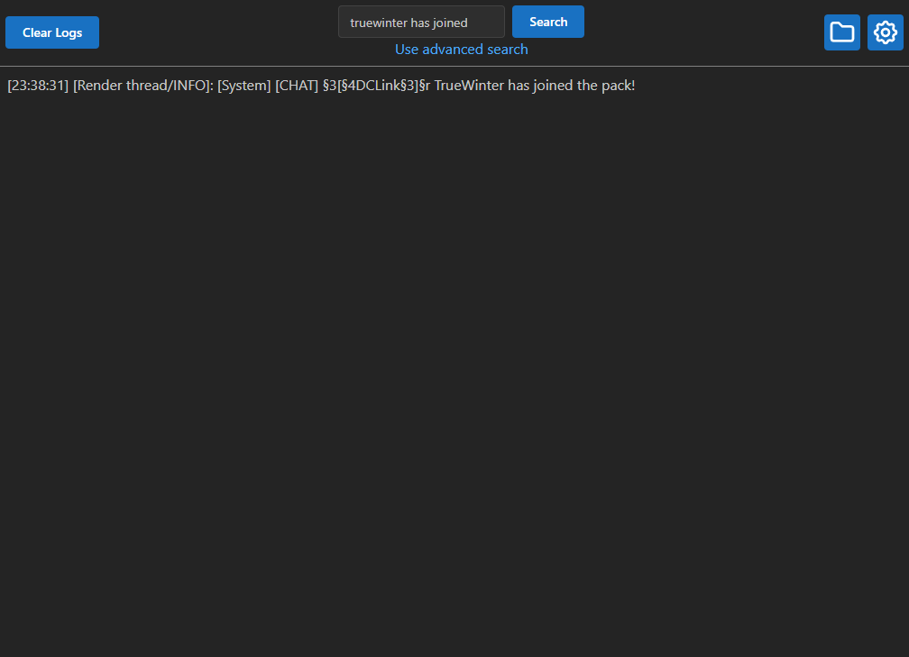
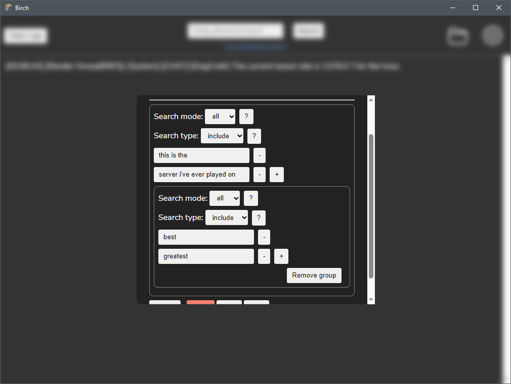
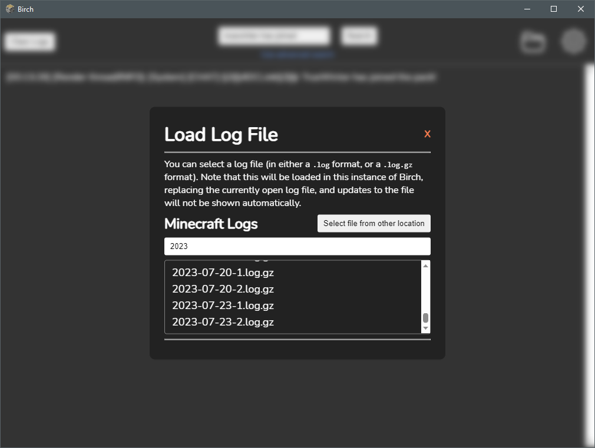

# Birch

Birch is a Minecraft log viewer that allows you to easily search chat logs. It can be used on Windows, Mac, and Linux.

|  |
|:---:|
| The main Birch window |

## Supported Operating Systems

- Windows 10/11
- MacOS (it works on Sonoma, compatibility with previous versions of macOS is not guaranteed)
- Linux (x64; requires GTK 3 and WebKitGTK)

## Usage

After installing and opening Birch, it should show the chat from your latest log file. If it can't find the file, your Minecraft installation might not be in the default location. This can be changed from the Birch settings.

On Linux, Birch uses `~/.minecraft` as the default Minecraft directory and stores its configuration and saved searches in `~/.local/share/TrueWinter/Birch`.

### Multiple Instances

Birch supports multiple Minecraft installations. Each instance has its own Minecraft directory and an optional default saved search. You can add, rename, and remove instances from the Birch settings, and switch between them using the instance button in the top-right corner. Switching instances applies immediately and starts watching the selected instance's `latest.log`.

### Advanced Search

There may be times when it would be useful to search for multiple things. The advanced search feature lets you create search groups which can be independently configured to filter messages in different ways.

There are two modes:
- `all`: match messages that contain all of the searched words
- `any`: match messages that contain any of the searched words

The search type can be set to `include` or `exclude` to control whether or not the messages need to contain the searched words. This allows you to hide messages that would otherwise appear in the search result.

|  |
|:---:|
| Birch allows you to do complex searches through the Advanced Search popup |

To return to simple search mode, press the search button in the header.

### Old Log Files

You can load old log files from your Minecraft folder, or from anywhere on your computer.

|  |
|:---:|
| Birch allows you to open old log files |

## Building

Each installer is built with a platform-specific script:

- `./build-darwin.sh` builds the macOS `.pkg` and must be run on macOS.
- `./build-windows.sh` builds the Windows installer and requires Wails' Windows packaging tools.
- `./build-linux.sh` builds the Linux `.AppImage` and must be run on Linux.

`./build.sh` runs the script for the current platform.

The Linux build requires the Wails dependencies, including Go, Node.js, GTK 3, and WebKitGTK. Distributions that only provide WebKitGTK 4.1 need to set `WAILS_TAGS=webkit2_41`. AppImage packaging also requires `appimagetool`.

## Disclaimer

Birch is not an official Minecraft product and is not approved by or associated with Mojang or Microsoft.